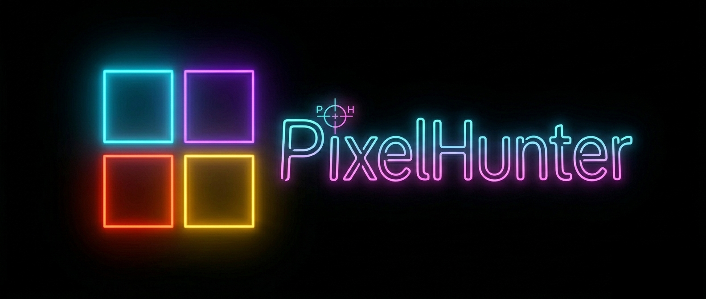

  
  <h1 align="center">🚦PixelHunter</h1>
  

   <strong>Neon and modern version of Battleship</strong>
    
    A strategic, turn-based pixel guessing game inspired by Battleship.
  

---

## 🎮 How to Play

### 1. Lobby & Matchmaking
* **Setup:** Enter your username and choose your color.
* **Rooms:** Create a new room or join an active one.

### 2. Placement Phase
* **The Grid:** Each player gets a 10x10 board.
* **Hide:** Select exactly **20 pixels** to conceal your targets.
* **Lock In:** Confirm your layout to start the match.

### 3. Playing Phase
* **Combat:** Take turns clicking the enemy grid to scan for pixels.
* **Hit:** Successful strikes light up with the opponent's color.
* **Miss:** Failed guesses turn dark grey.

---

## ⚡ Combo & Scoring

Consecutive hits trigger major point multipliers:

| Action | Score Effect |
| :--- | :--- |
| **💥 1st Hit** | `+1` point |
| **🔥 2nd Hit (Combo x2)** | `+99` points |
| **🚀 3rd Hit+** | Up to `+500` points per hit |
| **💀 Miss** | `-1` point & resets combo |

---

## 🏆 Win Conditions

The game ends immediately when a player achieves either:
* 🎯 **11 total hits** on opponent pixels.
* 🎖️ A score of **1,000 points**.

---

**Good luck, and happy pixel hunting!**
